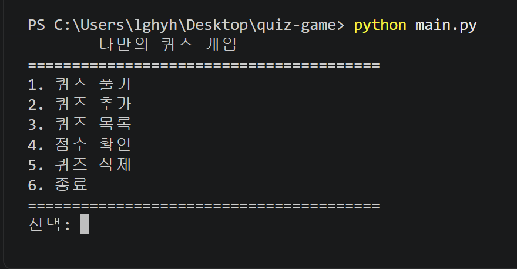
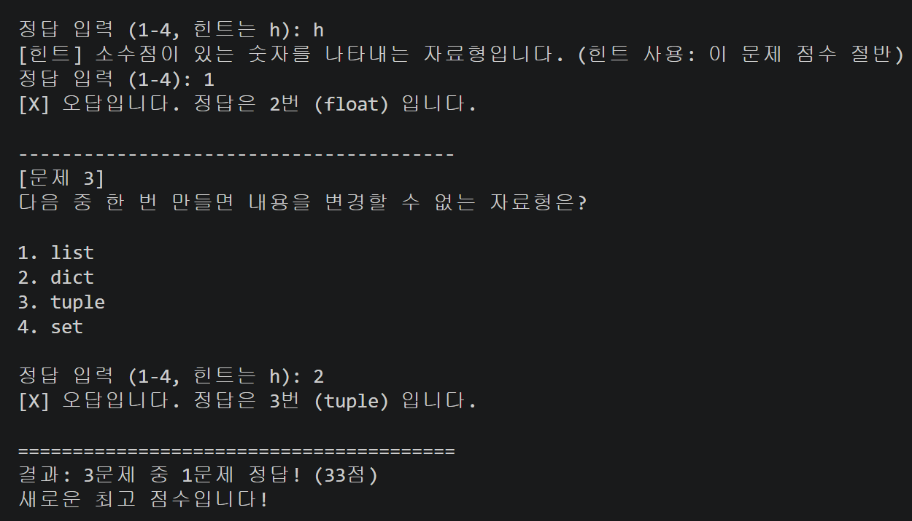
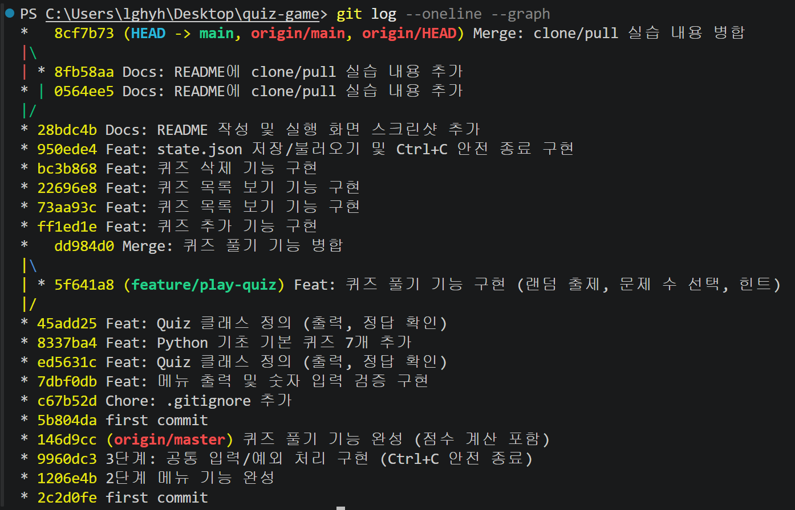

# 나만의 퀴즈 게임

## 프로젝트 개요

터미널에서 동작하는 Python 콘솔 퀴즈 게임입니다.
메뉴에서 번호를 골라 퀴즈를 풀고, 새 퀴즈를 추가하고, 목록과 점수를 확인할 수 있습니다.
퀴즈와 점수는 `state.json` 파일에 저장되어 프로그램을 종료하고 다시 실행해도 유지됩니다.

- Python 3.10 이상
- 외부 라이브러리 없음 (표준 라이브러리 `json`, `random`, `datetime`, `pathlib`만 사용)

## 퀴즈 주제와 선정 이유

주제: **Python 기초**

이 미션에서 Python 문법을 처음 배우고 있기 때문에, 배운 내용을 퀴즈로 만들면
문제를 내는 과정과 푸는 과정 모두에서 복습이 된다고 생각해 이 주제를 골랐습니다.

## 실행 방법

```bash
git clone https://github.com/ljs789/quiz-game.git
cd quiz-game
python main.py
```

## 기능 목록

| 메뉴 | 기능 | 설명 |
| --- | --- | --- |
| 1 | 퀴즈 풀기 | 풀 문제 수를 고르면 랜덤 순서로 출제하고, 정답/오답과 최종 결과를 보여 줍니다. |
| 2 | 퀴즈 추가 | 문제, 선택지 4개, 정답 번호, 힌트(선택)를 입력받아 저장합니다. |
| 3 | 퀴즈 목록 | 저장된 퀴즈 목록을 보여 줍니다. |
| 4 | 점수 확인 | 최고 점수와 최근 게임 기록을 보여 줍니다. |
| 5 | 퀴즈 삭제 | 번호를 골라 퀴즈를 삭제하고 파일에 반영합니다. |
| 6 | 종료 | 데이터를 저장하고 종료합니다. |

### 점수 계산

- 정답 1점, 힌트(`h`)를 보고 맞히면 0.5점, 오답 0점
- 점수 = (얻은 점수 ÷ 푼 문제 수) × 100 을 반올림한 값 (100점 만점)

### 입력/예외 처리

- 입력 앞뒤 공백은 제거한 뒤 처리합니다.
- 빈 입력, 숫자가 아닌 입력, 범위를 벗어난 숫자는 안내 메시지를 출력하고 다시 입력받습니다.
- `Ctrl+C`(KeyboardInterrupt)나 입력 종료(EOFError)가 발생하면 안내 메시지를 출력하고 저장한 뒤 종료합니다.
- `state.json`이 없으면 기본 퀴즈로 시작하고, 손상되었으면 안내 메시지를 출력한 뒤 기본 퀴즈로 복구합니다.

## 파일 구조

```
.
├── main.py          # 실행 파일 (QuizGame을 만들어 실행)
├── quiz.py          # Quiz 클래스: 퀴즈 한 문제 (출력, 정답 확인, dict 변환)
├── quiz_game.py     # QuizGame 클래스: 메뉴, 풀기/추가/목록/삭제, 점수, 저장/불러오기
├── state.json       # 데이터 파일 (실행하면 자동으로 만들어짐)
├── .gitignore
├── README.md
└── docs/
    └── screenshots/ # 실행 화면 스크린샷
```

## 데이터 파일 설명 (`state.json`)

- 경로: 프로젝트 루트의 `state.json`
- 역할: 퀴즈 목록, 최고 점수, 게임 기록을 저장합니다. 퀴즈를 추가/삭제하거나 게임이 끝날 때, 프로그램을 종료할 때 저장됩니다.
- 인코딩: UTF-8

| 키 | 자료형 | 설명 |
| --- | --- | --- |
| `quizzes` | list | 퀴즈 목록 |
| `quizzes[].question` | str | 문제 |
| `quizzes[].choices` | list (str 4개) | 선택지 |
| `quizzes[].answer` | int (1~4) | 정답 번호 |
| `quizzes[].hint` | str | 힌트 (없으면 빈 문자열) |
| `best_score` | int 또는 null | 최고 점수 (아직 풀지 않았으면 null) |
| `history` | list | 게임 기록 |
| `history[].datetime` | str | 게임을 끝낸 날짜/시간 |
| `history[].total` | int | 푼 문제 수 |
| `history[].correct` | int | 맞힌 문제 수 |
| `history[].score` | int | 점수 |

예시:

```json
{
    "quizzes": [
        {
            "question": "Python을 만든 사람은?",
            "choices": ["귀도 반 로섬", "리누스 토르발스", "제임스 고슬링", "데니스 리치"],
            "answer": 1,
            "hint": "이름이 'G'로 시작합니다."
        }
    ],
    "best_score": 80,
    "history": [
        {
            "datetime": "2026-11-15 10:00:00",
            "total": 5,
            "correct": 4,
            "score": 80
        }
    ]
}
```

## 기본 퀴즈 데이터

- 기본 퀴즈는 **7개**(주제: Python 기초)이며, `quiz_game.py`의 `create_default_quizzes()` 함수에 정의되어 있습니다.
- `state.json`이 없거나 손상되었을 때 이 7개로 시작합니다.

## 클래스 설계 이유

| 클래스 | 책임 | 이렇게 나눈 이유 |
| --- | --- | --- |
| `Quiz` | 문제 1개(문제, 선택지 4개, 정답, 힌트)를 표현하고 출력, 정답 확인, dict 변환을 담당 | 문제 하나에 필요한 데이터와 동작을 한 곳에 묶어(추상화) 같은 틀로 문제를 여러 개 만들 수 있게(재사용) 했습니다. |
| `QuizGame` | 퀴즈 목록과 점수를 가지고 메뉴, 풀기, 추가, 목록, 삭제, 저장/불러오기를 담당 | 게임 진행 규칙을 Quiz와 분리해, 문제 형식을 바꿔도 게임 흐름은 그대로 두고, 게임 흐름을 바꿔도 Quiz는 그대로 둘 수 있게 했습니다. |

## 데이터 흐름

1. **시작**: `QuizGame()` 생성 → `load_state()`로 `state.json`을 읽음 (없으면 기본 퀴즈, 손상되면 안내 후 기본 퀴즈로 복구)
2. **실행 중**: 퀴즈 추가, 삭제, 게임 종료(점수 갱신) 때마다 `save_state()`로 파일 전체를 다시 저장
3. **종료**: 메뉴 6번, `Ctrl+C`, 입력 종료(EOF) 모두 `save_state()` 후 종료

## 실행 확인 방법

| 확인할 것 | 입력 | 기대 결과 |
| --- | --- | --- |
| 공백 제거 | ` 1 ` | 1번 메뉴(퀴즈 풀기)로 이동 |
| 문자 입력 | `abc` | `[!] 잘못된 입력입니다. 1-6 사이의 숫자를 입력하세요.` 후 다시 입력 |
| 범위 밖 숫자 | `9` | 같은 안내 후 다시 입력 |
| 빈 입력 | 그냥 Enter | `[!] 입력이 비어 있습니다.` 후 다시 입력 |
| 힌트 | 문제 풀이 중 `h` | 힌트 출력, 맞히면 그 문제는 0.5점 |
| 데이터 유지 | 퀴즈 추가 → 6번 종료 → 다시 실행 | `저장된 데이터를 불러왔습니다. (퀴즈 8개, ...)` |
| 안전 종료 | 메뉴에서 `Ctrl+C` | `[!] 입력이 중단되었습니다. 데이터를 저장하고 종료합니다.` |
| 손상 파일 | `state.json` 내용을 `{abc`로 바꾸고 실행 | `[!] 데이터 파일이 손상되었습니다. 기본 퀴즈로 복구합니다.` |

## 백업과 복구

- 현재 자동 백업 기능은 없습니다. 파일이 손상되면 안내 메시지를 출력하고 기본 퀴즈로 초기화합니다.
- 수동 백업: 실행 전에 `state.json`을 `state.backup.json`처럼 복사해 두면 됩니다.
- 복구 방법: 손상된 `state.json`을 지우고 백업 파일 이름을 `state.json`으로 바꾼 뒤 다시 실행합니다.
- 저장 실패(권한 오류 등) 시 `[!] 파일 저장에 실패했습니다` 메시지가 나옵니다. 프로젝트 폴더에 쓰기 권한이 있는지, 다른 프로그램이 파일을 열고 있지 않은지 확인합니다.
- 개선 방향: 저장 전에 기존 파일을 `state_YYYYMMDD_HHMMSS.json`으로 복사하는 자동 백업을 추가할 수 있습니다.

## 데이터가 많아질 때 (1000개 이상)

| 부분 | 현재 방식 | 예상 문제 | 개선 방향 |
| --- | --- | --- | --- |
| 불러오기 | 시작할 때 JSON 전체를 메모리에 올림 | 수천 개도 문제없지만 수십만 개면 시작이 느려짐 | SQLite 같은 데이터베이스로 필요한 것만 읽기 |
| 저장 | 추가/삭제할 때마다 파일 전체를 다시 씀 | 개수가 많을수록 저장 시간이 늘어남 | 종료 시에만 저장하거나 데이터베이스 사용 |
| 목록 보기 | 전체를 한 번에 출력 | 1000줄이 넘으면 화면에서 찾기 어려움 | 10개씩 페이지 나누기, 키워드 검색 |
| 출제 | `random.sample`로 무작위 추출 | 1000개 정도는 빠름 | 그대로 사용 가능 |
| 기록(history) | 게임할 때마다 계속 늘어남 | 파일이 점점 커짐 | 최근 N개만 보관 |

## 요구사항이 바뀔 때 고칠 곳

| 바뀌는 요구 | 고칠 곳 |
| --- | --- |
| 점수 계산 방식 | `QuizGame.play_quiz()`의 `points`, `score` 계산 부분 |
| 선택지 개수 (예: 5개) | `Quiz.CHOICE_COUNT`, 입력 안내 문구 |
| 퀴즈에 새 정보 추가 (예: 난이도) | `Quiz.__init__`, `to_dict()`, `from_dict()`, `add_quiz()` |
| 메뉴 추가 | `MENU_...` 상수, `show_menu()`, `run()`의 if/elif |
| 저장 형식이나 위치 | `STATE_FILE`, `save_state()`, `load_state()`, `parse_state()` |
| 기본 퀴즈 내용 | `create_default_quizzes()` |

## JSON을 선택한 이유

- 사람이 열어서 바로 읽고 고칠 수 있습니다.
- 퀴즈처럼 "선택지 목록이 들어 있는 데이터"를 그대로 담을 수 있습니다. (CSV는 표 형태라 목록 안에 목록을 넣기 어렵습니다.)
- Python 기본 모듈 `json`만으로 읽고 쓸 수 있어 외부 라이브러리가 필요 없습니다.

## 커밋 규칙

- **기능 하나를 완성하고 실행으로 확인한 뒤** 커밋합니다. (예: 메뉴, Quiz 클래스, 퀴즈 풀기, 추가, 목록, 점수, 삭제, 저장, README)
- 메시지 형식: `타입: 변경 요약`

| 타입 | 쓰는 경우 | 이 저장소의 예시 |
| --- | --- | --- |
| `Feat` | 새 기능 | `Feat: 퀴즈 삭제 기능 구현` |
| `Fix` | 오류 수정 | `Fix: README 병합 표시 제거` |
| `Docs` | 문서, 스크린샷 | `Docs: README 작성 및 실행 화면 스크린샷 추가` |
| `Refactor` | 동작은 같고 구조만 개선 | `Refactor: QuizGame 책임 분리` |
| `Chore` | 설정 파일 등 기타 | `Chore: .gitignore 추가` |
| `Merge` | 브랜치 병합 | `Merge: 퀴즈 풀기 기능 병합` |

## 브랜치와 병합 기록

- `feature/play-quiz` 브랜치에서 퀴즈 풀기 기능을 만든 뒤 `main`에 병합했습니다. (`Merge: 퀴즈 풀기 기능 병합`)
- `git clone`으로 만든 `quiz-clone` 폴더에서 README를 수정해 push하고, 원래 폴더에서 `git pull`로 받아 병합했습니다. (`Merge: clone/pull 실습 내용 병합`)

## 실행 화면

### 메뉴


### 퀴즈 풀기


### 퀴즈 추가


### 점수 확인


### 퀴즈 목록


## 제출 자료

### 개발 환경


### Git 커밋 기록 (git log --oneline --graph)


- 커밋 20개 이상, 브랜치 병합 2회 (`feature/play-quiz` 병합, clone/pull 실습 병합)