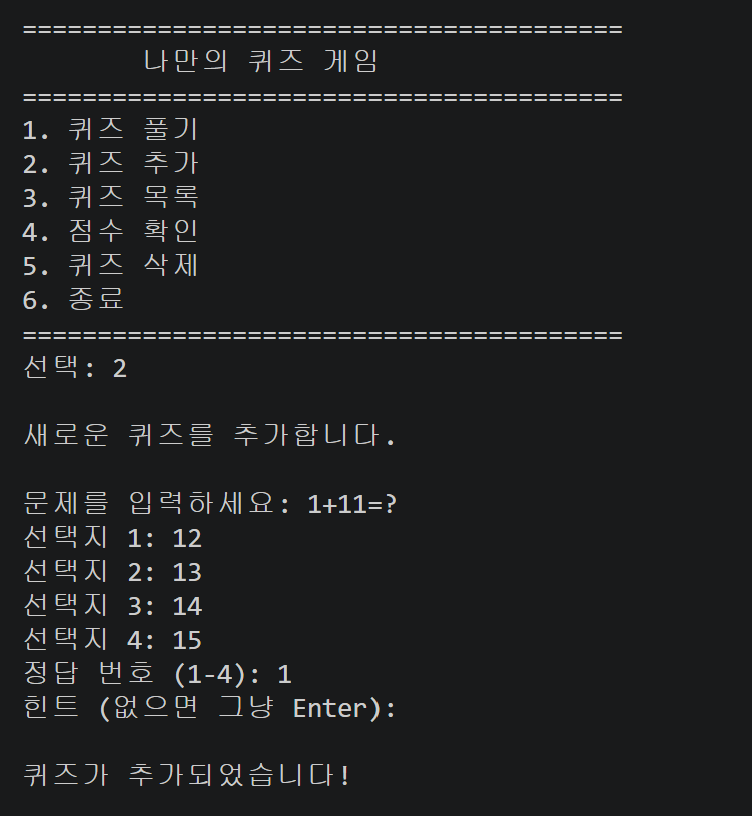
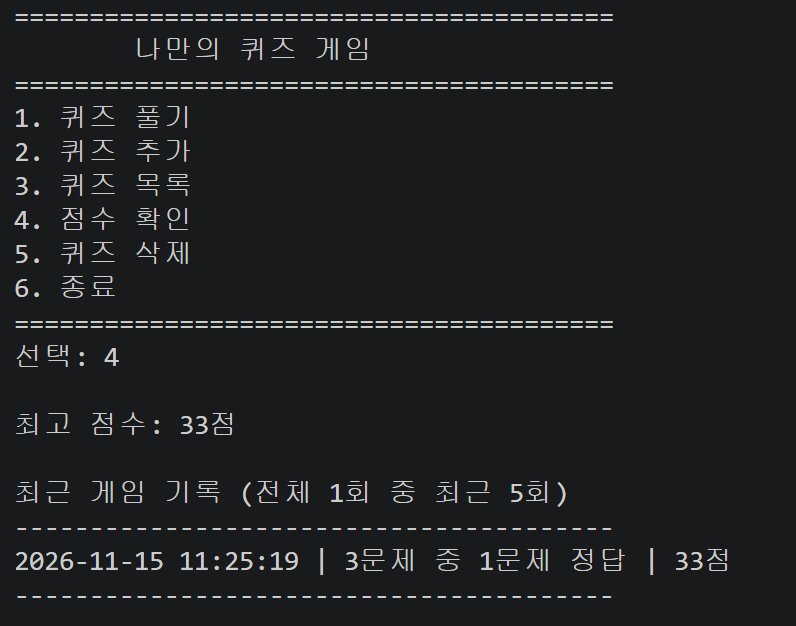
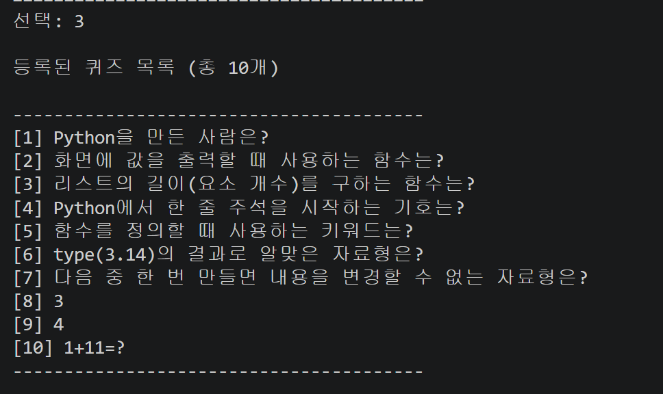
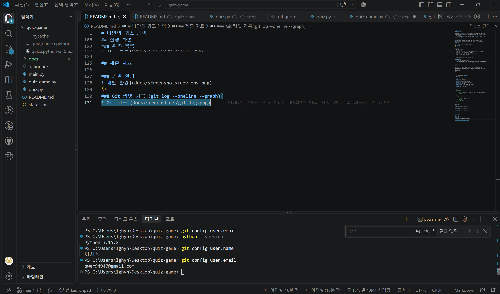

# 나만의 퀴즈 게임

## 프로젝트 개요

터미널에서 동작하는 Python 콘솔 퀴즈 게임입니다.
메뉴에서 번호를 골라 퀴즈를 풀고, 새 퀴즈를 추가하고, 목록과 점수를 확인할 수 있습니다.
퀴즈와 점수는 `state.json` 파일에 저장되어 프로그램을 종료하고 다시 실행해도 유지됩니다.

- Python 3.10 이상
- 외부 라이브러리 없음 (표준 라이브러리 `json`, `random`, `datetime`, `pathlib`만 사용)

## 퀴즈 주제와 선정 이유

주제: **Python 기초**

이 미션에서 Python 문법을 처음 배우고 있기 때문에, 배운 내용을 퀴즈로 만들면
문제를 내는 과정과 푸는 과정 모두에서 복습이 된다고 생각해 이 주제를 골랐습니다.

## 실행 방법

```bash
git clone https://github.com/ljs789/저장소이름.git
cd 저장소이름
python main.py
```

## 기능 목록

| 메뉴 | 기능 | 설명 |
| --- | --- | --- |
| 1 | 퀴즈 풀기 | 풀 문제 수를 고르면 랜덤 순서로 출제하고, 정답/오답과 최종 결과를 보여 줍니다. |
| 2 | 퀴즈 추가 | 문제, 선택지 4개, 정답 번호, 힌트(선택)를 입력받아 저장합니다. |
| 3 | 퀴즈 목록 | 저장된 퀴즈 목록을 보여 줍니다. |
| 4 | 점수 확인 | 최고 점수와 최근 게임 기록을 보여 줍니다. |
| 5 | 퀴즈 삭제 | 번호를 골라 퀴즈를 삭제하고 파일에 반영합니다. |
| 6 | 종료 | 데이터를 저장하고 종료합니다. |

### 점수 계산

- 정답 1점, 힌트(`h`)를 보고 맞히면 0.5점, 오답 0점
- 점수 = (얻은 점수 ÷ 푼 문제 수) × 100 을 반올림한 값 (100점 만점)

### 입력/예외 처리

- 입력 앞뒤 공백은 제거한 뒤 처리합니다.
- 빈 입력, 숫자가 아닌 입력, 범위를 벗어난 숫자는 안내 메시지를 출력하고 다시 입력받습니다.
- `Ctrl+C`(KeyboardInterrupt)나 입력 종료(EOFError)가 발생하면 안내 메시지를 출력하고 저장한 뒤 종료합니다.
- `state.json`이 없으면 기본 퀴즈로 시작하고, 손상되었으면 안내 메시지를 출력한 뒤 기본 퀴즈로 복구합니다.

## 파일 구조

```
.
├── main.py          # 실행 파일 (QuizGame을 만들어 실행)
├── quiz.py          # Quiz 클래스: 퀴즈 한 문제 (출력, 정답 확인, dict 변환)
├── quiz_game.py     # QuizGame 클래스: 메뉴, 풀기/추가/목록/삭제, 점수, 저장/불러오기
├── state.json       # 데이터 파일 (실행하면 자동으로 만들어짐)
├── .gitignore
├── README.md
└── docs/
    └── screenshots/ # 실행 화면 스크린샷
```

## 데이터 파일 설명 (`state.json`)

- 경로: 프로젝트 루트의 `state.json`
- 역할: 퀴즈 목록, 최고 점수, 게임 기록을 저장합니다. 퀴즈를 추가/삭제하거나 게임이 끝날 때, 프로그램을 종료할 때 저장됩니다.
- 인코딩: UTF-8

| 키 | 자료형 | 설명 |
| --- | --- | --- |
| `quizzes` | list | 퀴즈 목록 |
| `quizzes[].question` | str | 문제 |
| `quizzes[].choices` | list (str 4개) | 선택지 |
| `quizzes[].answer` | int (1~4) | 정답 번호 |
| `quizzes[].hint` | str | 힌트 (없으면 빈 문자열) |
| `best_score` | int 또는 null | 최고 점수 (아직 풀지 않았으면 null) |
| `history` | list | 게임 기록 |
| `history[].datetime` | str | 게임을 끝낸 날짜/시간 |
| `history[].total` | int | 푼 문제 수 |
| `history[].correct` | int | 맞힌 문제 수 |
| `history[].score` | int | 점수 |

예시:

```json
{
    "quizzes": [
        {
            "question": "Python을 만든 사람은?",
            "choices": ["귀도 반 로섬", "리누스 토르발스", "제임스 고슬링", "데니스 리치"],
            "answer": 1,
            "hint": "이름이 'G'로 시작합니다."
        }
    ],
    "best_score": 80,
    "history": [
        {
            "datetime": "2026-11-15 10:00:00",
            "total": 5,
            "correct": 4,
            "score": 80
        }
    ]
}
```

## 실행 화면

### 메뉴


### 퀴즈 풀기


### 퀴즈 추가


### 점수 확인


### 퀴즈 목록


## 제출 자료

### 개발 환경


### Git 커밋 기록 (git log --oneline --graph)
